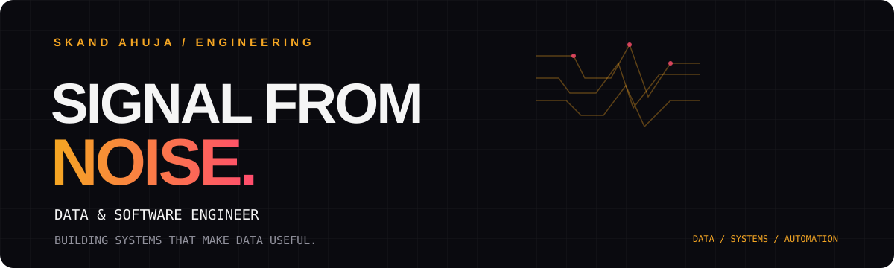

<!-- ===================================================== -->
<!-- SKAND AHUJA | GITHUB PROFILE README                  -->
<!-- DESIGN: SIGNAL FROM NOISE                            -->
<!-- ===================================================== -->

<div align="center">
  

  <br/>

  <h3>DATA & SOFTWARE ENGINEER</h3>

  <p>
    <strong>Building systems that make data useful.</strong>
  </p>

  <p>
    <a href="https://www.linkedin.com/in/skand-ahuja/">
      
    </a>
    <a href="https://github.com/skand-ahuja">
      
    </a>
  </p>
</div>

---

## 01 / THE IDEA

I work at the intersection of **data, software engineering, and automation**.

I take fragmented data, disconnected tools, and repetitive business processes and turn them into systems that people can actually use.

My work spans the complete solution lifecycle:

- Extracting, transforming, and structuring data.
- Building automated reporting pipelines.
- Developing analytics dashboards and internal platforms.
- Designing APIs, databases, and user interfaces.
- Turning business requirements into maintainable software.

I care about more than getting the code to work. I care about whether the system solves the actual problem.

---

## 02 / ENGINEERING IN NUMBERS

<div align="center">
  <table>
    <tr>
      <td align="center" width="33%">
        <h1>115+</h1>
        <sub>PROJECTS TRACKED</sub>
      </td>
      <td align="center" width="33%">
        <h1>29</h1>
        <sub>BUSINESS KPIs</sub>
      </td>
      <td align="center" width="33%">
        <h1>20 MIN</h1>
        <sub>REPORT PREPARATION</sub>
      </td>
    </tr>
  </table>
  <sub>Selected outcomes from professional internal-platform and reporting work.</sub>
</div>

One finance reporting workflow went from approximately **3–4 hours to 20 minutes** of preparation time.

A PMO monitoring platform brought visibility across **115+ projects and 29 KPIs**.

---

## 03 / TECHNICAL TOOLKIT

**DATA & ANALYTICS**


**FULL-STACK DEVELOPMENT**


**DATABASES & VISUALIZATION**


**AUTOMATION & TOOLS**


---

## 04 / SELECTED WORK

### 01. Job Market Trends Analysis

Exploring job market data to understand salary patterns, hiring trends, and in-demand skills.

**Stack:** Python · Pandas · NumPy · Statistics

[VIEW REPOSITORY →](https://github.com/skand-ahuja/Job-Market-Trends-Analysis)

### 02. Ola Booking Data Analysis

Analyzing booking patterns, cancellations, customer behaviour, and business performance using SQL and Power BI.

**Stack:** SQL Server · SQL · Power BI

[VIEW REPOSITORY →](https://github.com/skand-ahuja/Ola-Booking-Data-Analysis)

### 03. Coffee Shop Sales Dashboard

An interactive sales analysis project exploring product performance, revenue patterns, and business trends.

**Stack:** Excel · Power Query · Power Pivot · DAX

[VIEW REPOSITORY →](https://github.com/skand-ahuja/Coffee-Shop-Sales-Dashboard)

---

## 05 / HOW I THINK ABOUT ENGINEERING

```text
UNDERSTAND THE PROBLEM
          ↓
      FIND THE DATA
          ↓
   STRUCTURE THE SYSTEM
          ↓
    AUTOMATE THE WORK
          ↓
   MAKE RESULTS VISIBLE
          ↓
     IMPROVE & ITERATE
```

Good engineering is not about using the most tools.

It is about choosing the right tools, understanding the constraints, and building something that makes work simpler.

---

## 06 / BEYOND THE CODE

Currently interested in:

- Analytics engineering and data platforms.
- Business process automation.
- Full-stack internal applications.
- Data visualization and decision-support systems.
- Building software that solves practical problems.

---

<div align="center">

  <h3>LET'S CONNECT</h3>

  <a href="https://www.linkedin.com/in/skand-ahuja/">
    LinkedIn
  </a>
  &nbsp; · &nbsp;
  <a href="https://github.com/skand-ahuja">
    GitHub
  </a>

  <br/><br/>

  <sub>TURNING COMPLEXITY INTO CLARITY.</sub>

</div>
