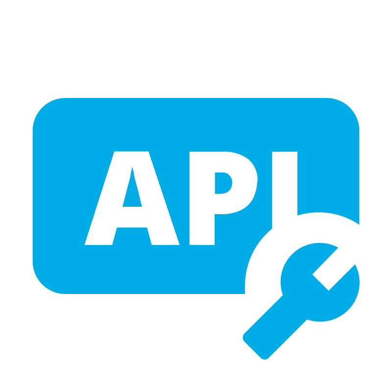
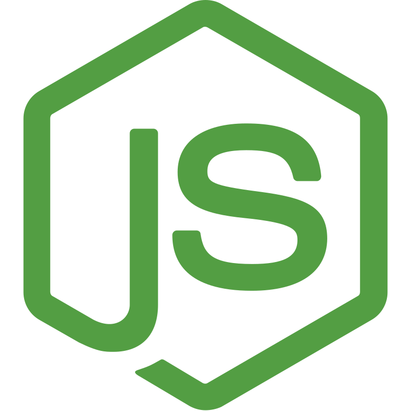
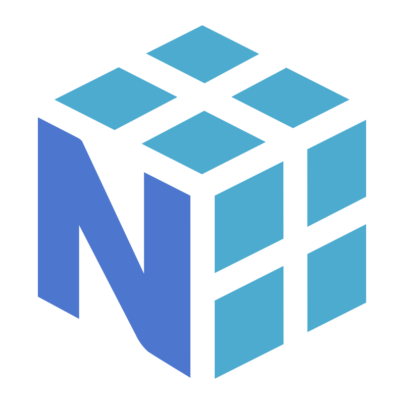
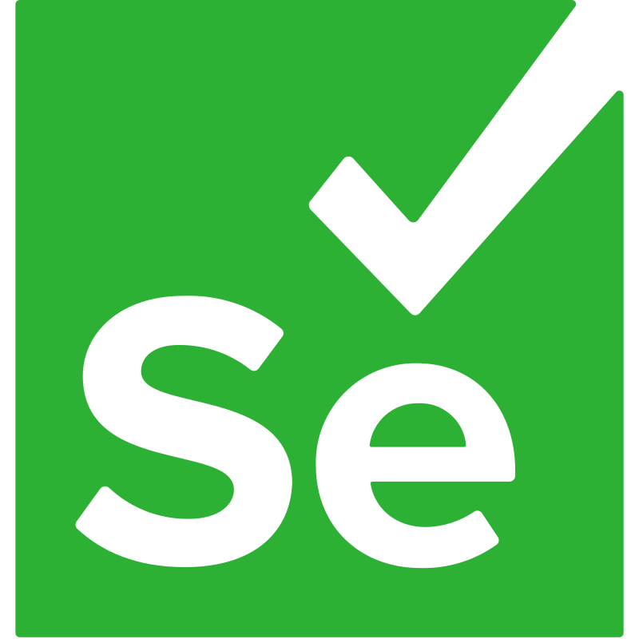
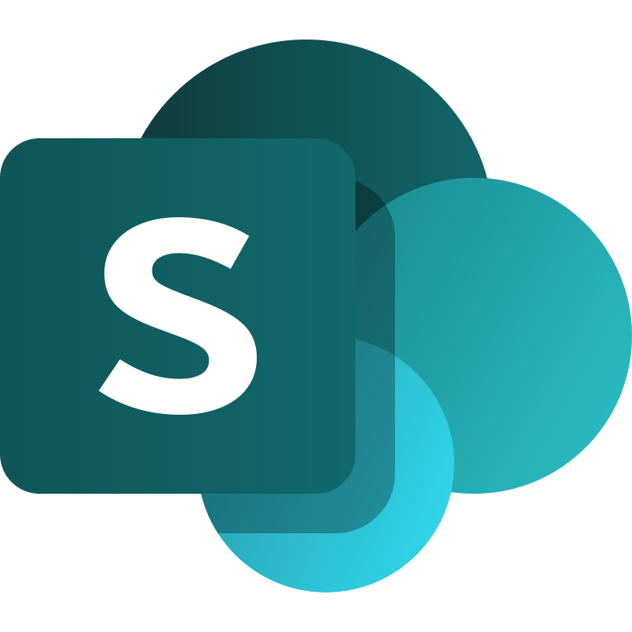

<!-- ====================================================== -->
<!--                     HERO SECTION                      -->
<!-- ====================================================== -->

<div align="center">

  <!-- Animated Header -->
  

  <!-- Typing Animation -->
  <br/>

  

  <br/><br/>

  <!-- Social Links -->
  <a href="YOUR_LINKEDIN_PROFILE_URL">
    
  </a>
  &nbsp;
  <a href="https://github.com/skand-ahuja">
    
  </a>
  &nbsp;
  <a href="https://github.com/skand-ahuja/portfolio-website">
    
  </a>

  <br/><br/>

  <!-- Profile Views Counter -->
  

</div>

<!-- =================== END HERO SECTION ================== -->


<!-- ====================================================== -->
<!--                    ABOUT SECTION                      -->
<!-- ====================================================== -->

<br/>

<h2 align="center">ABOUT ME</h2>

<div align="center">
  
</div>

<br/>

```python
class SkandAhuja:

    def __init__(self):
        self.name = "Skand Ahuja"
        self.role = "Data & Software Engineer"
        self.current_role = "Data Analyst"
        self.company = "GNAP Services"

    @property
    def working_on(self):
        return [
            "Business Intelligence & Data Analytics",
            "Workflow and Reporting Automation",
            "Full-Stack Data Applications",
            "Scalable Internal Business Systems"
        ]

    @property
    def technologies(self):
        return {
            "languages": ["Python", "SQL", "JavaScript"],
            "frontend": ["React", "HTML", "Tailwind CSS"],
            "backend": ["Node.js", "Express.js", "Flask"],
            "data": ["Power BI", "Pandas", "NumPy"],
            "database": ["PostgreSQL", "MySQL", "SQL Server"],
            "automation": ["Power Automate", "Selenium"]
        }

    @property
    def philosophy(self):
        return "Building systems that make data useful."


me = SkandAhuja()
```

<br/>

<div align="center">

  <table>
    <tr>
      <td align="center" width="33%">
        
        <br/><b>ANALYTICS</b>
        <br/><sub>Turning data into decisions</sub>
      </td>
      <td align="center" width="33%">
        
        <br/><b>AUTOMATION</b>
        <br/><sub>Reducing repetitive work</sub>
      </td>
      <td align="center" width="33%">
        
        <br/><b>ENGINEERING</b>
        <br/><sub>Building useful systems</sub>
      </td>
    </tr>
  </table>

</div>

<!-- ================= END ABOUT SECTION =================== -->


<!-- Professional Introduction -->

<p align="center">
  I work at the intersection of <b>Data Analytics</b>,
  <b>Workflow Automation</b>, and <b>Full-Stack Development</b>.
  <br/>
  My focus is building practical systems that simplify business
  operations, reduce repetitive work, and turn complex data into
  actionable insights.
</p>

<br/>

<div align="center">

  
  &nbsp;&nbsp;
  
  &nbsp;&nbsp;
  

</div>

<br/>


<!-- ====================================================== -->
<!--                    TECH STACK                         -->
<!-- ====================================================== -->

<br/><br/>

<h2 align="center">TECH STACK</h2>

<div align="center">

  

</div>

<br/>

<!-- PROGRAMMING -->

<h3 align="center">01 / PROGRAMMING</h3>

<div align="center">

  
  &nbsp;&nbsp;&nbsp;
  
  &nbsp;&nbsp;&nbsp;
  

</div>

<br/>

<!-- FRONTEND AND BACKEND -->

<h3 align="center">02 / FRONTEND & BACKEND</h3>

<div align="center">

  
  &nbsp;&nbsp;&nbsp;
  
  &nbsp;&nbsp;&nbsp;
  
  &nbsp;&nbsp;&nbsp;
  
  &nbsp;&nbsp;&nbsp;
  

</div>

<br/>

<!-- DATABASES -->

<h3 align="center">03 / DATABASES</h3>

<div align="center">

  
  &nbsp;&nbsp;&nbsp;
  

</div>

<br/>

<!-- DATA AND BI -->

<h3 align="center">04 / DATA & BUSINESS INTELLIGENCE</h3>

<div align="center">

  
  &nbsp;&nbsp;&nbsp;
  
  &nbsp;&nbsp;&nbsp;
  
  &nbsp;&nbsp;&nbsp;
  
  &nbsp;&nbsp;&nbsp;
  

</div>

<br/>

<!-- AUTOMATION AND BUSINESS TOOLS -->

<h3 align="center">05 / AUTOMATION & BUSINESS TOOLS</h3>

<div align="center">

  
  &nbsp;&nbsp;&nbsp;
  
  &nbsp;&nbsp;&nbsp;
  
  &nbsp;&nbsp;&nbsp;
  

</div>

<!-- ================= END TECH STACK ===================== -->


<!-- ====================================================== -->
<!--                  FEATURED PROJECTS                    -->
<!-- ====================================================== -->

<br/><br/>

<h2 align="center">FEATURED PROJECTS</h2>

<div align="center">

</div>

<br/>

<table>
<tr>
<td width="50%" valign="top">

<a href="https://github.com/skand-ahuja/Job-Market-Trends-Analysis">

</a>

<h4>01 / JOB MARKET TRENDS ANALYSIS</h4>

<p>Exploring job-market data to identify patterns, trends, and insights.</p>

<a href="https://github.com/skand-ahuja/Job-Market-Trends-Analysis">

</a>

</td>
<td width="50%" valign="top">

<a href="https://github.com/skand-ahuja/Ola-Booking-Data-Analysis">

</a>

<h4>02 / OLA BOOKING DATA ANALYSIS</h4>

<p>Analyzing ride-booking data to explore operational patterns and business insights.</p>

<a href="https://github.com/skand-ahuja/Ola-Booking-Data-Analysis">

</a>

</td>
</tr>

<tr>
<td width="50%" valign="top">

<a href="https://github.com/skand-ahuja/Coffee-Shop-Sales-Dashboard">

</a>

<h4>03 / COFFEE SHOP SALES DASHBOARD</h4>

<p>Sales analytics focused on business performance and trend exploration.</p>

<a href="https://github.com/skand-ahuja/Coffee-Shop-Sales-Dashboard">

</a>

</td>
<td width="50%" valign="top">

<a href="https://github.com/skand-ahuja/Zomato-Data-Analysis">

</a>

<h4>04 / ZOMATO DATA ANALYSIS</h4>

<p>Restaurant-data analysis to explore patterns and business insights.</p>

<a href="https://github.com/skand-ahuja/Zomato-Data-Analysis">

</a>

</td>
</tr>
</table>

<br/>

<div align="center">
<a href="https://github.com/skand-ahuja?tab=repositories">

</a>
</div>

<!-- ================= END FEATURED PROJECTS ============== -->


<!-- ====================================================== -->
<!--                   GITHUB ANALYTICS                    -->
<!-- ====================================================== -->

<br/><br/>

<h2 align="center">GITHUB ANALYTICS</h2>

<div align="center">

</div>

<br/>

<!-- GITHUB STATS -->

<div align="center">

  

  

</div>

<br/>

<!-- CONTRIBUTION STREAK -->

<div align="center">

  

</div>

<br/>

<!-- CONTRIBUTION ACTIVITY GRAPH -->

<h3 align="center">CONTRIBUTION ACTIVITY</h3>

<div align="center">

  

</div>

<!-- ================= END GITHUB ANALYTICS =============== -->


<!-- ====================================================== -->
<!--                 CONTRIBUTION SNAKE                    -->
<!-- ====================================================== -->

<br/><br/>

<h2 align="center">CONTRIBUTION ACTIVITY</h2>

<div align="center">

  

  <br/><br/>

  <picture>
    <source media="(prefers-color-scheme: dark)" srcset="https://raw.githubusercontent.com/skand-ahuja/skand-ahuja/output/github-snake-dark.svg"/>
    <source media="(prefers-color-scheme: light)" srcset="https://raw.githubusercontent.com/skand-ahuja/skand-ahuja/output/github-snake.svg"/>
    
  </picture>

</div>

<!-- ============== END CONTRIBUTION SNAKE ================ -->

